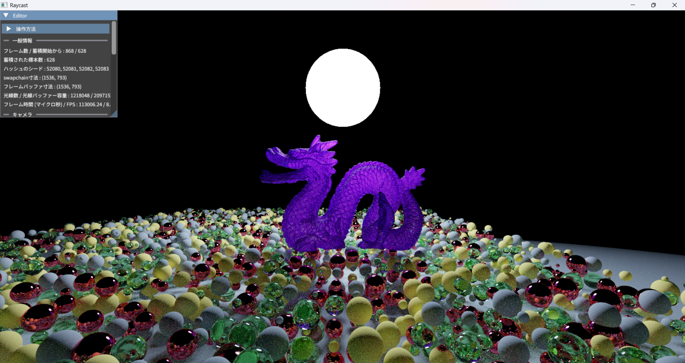
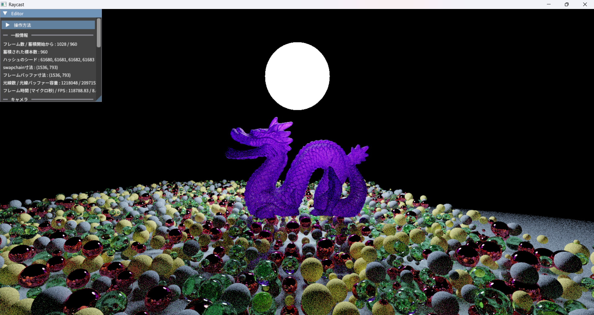

# Raytracer demo
C++, Vulkanで開発したGPUベースのRay tracerです。

外部ライブラリーはtiny_bvhとDear ImGuiを私用しています。

開発期間は約２週間です。

## Ray tracerとは
レイトレーシング（Ray Tracing）は、光線を追跡することによって3Dシーンを描画するレンダリング手法です。
本アプリでは、光線を確率的に追跡し、複数回の反射を考慮して画素の色を推定する**パストレーシング（Path Tracing）**を実装しています。

## アプリの流れ
1. 初期設定でvulkanのインスタンス(GPUなど)を立ち上げます
2. 3D空間の中の球体の大きさ、物質、位置などを生成または読み込みます。
3. カメラの初期設定
4. アプリが終了するまで、繰り返し描画

## 描画の流れ
1. 乱数生成に必要なseedを準備
2. カメラの位置や向きに基づき、光線の始点と方向を計算
3. 各光線にあたり、交差判定、衝突位置の色と反射した後の方向を計算
4. 最大反射回数に達するまでステップ３～４を繰り返す
5. 光線の色で各画素に色を推定し、画面に書き込む。その後ステップ１に戻る

ステップ２～５はすべてGPUのシェーダーで行われます。

## ビルド方法
現在、プラットフォームはWindowsでコンパイラーはg++とmsvc (cl.exe) しか対応されていません。
尚、以下の条件を満たさないパソコンではコンパイル・実行が不可能なので予めご確認ください
- Windows x86-64 (Windows 11ではかならず満たされています)
- AVX2及びFMA対応CPU
- Vulkan 1.3対応
- (g++でコンパイルいただく方) GCC (MinGW-w64 UCRT64), C++
- (msvcでコンパイルいたたく方) MSVC x64

g++:
以下のコマンドを実行してください。

```
cmd
build
```

msvc:
cl(64ビット対応モード)を有効にしたターミナルで、以下のコマンドを実行してください。
```
cmd
msvc_build
```

MSVCのビルド環境が設定されていない場合は、Visual Studioの「x64 Native Tools Command Prompt」を使用するか、vcvars64.batを実行してください。

例えば、Visual Studio 2022 Communityが標準のパスにインストールされている場合は、以下のコマンドで設定できます。
```
"C:\Program Files\Microsoft Visual Studio\2022\Community\VC\Auxiliary\Build\vcvars64"
```
Visual Studioのバージョン、エディションおよびインストール先によってパスが異なるため、適宜変更してください。

buildコマンドを実行したとき、releaseモードでコンパイルします。devモードでコンパイルがしたい場合は、g++で`build dev`を実行してください。

## アプリの説明
現時点で描画に対応しているオブジェクトは球体のみです。
これは開発期間を約2週間に抑えるための仕様上の制限です。

本アプリはモンテカルロ法を用いて画素の色を推定しています。連続的な画像を有限個のサンプルから完全に再現することはできないため、多数の光線を追跡し、統計的な手法(Monte Carlo estimation)で画素値を推定します。

以下では、主にカメラから発射する光線1本に対応する試行を「サンプル」と呼びます。

サンプル数を増やすことで、一般に推定値のばらつきが小さくなり、画像が徐々に収束していきます。

## GUI内のパラメーターの説明
- 色の蓄積 (Color accumulation) とは、過去の描画結果を使うことによってより正確な画像を生成するテクニックです。解像度の高い画像をレンダーしたい時にはなるべく多いサンプル数が望ましいですが、一つのフレームで採れるサンプルの数が限られています。よって、過去サンプルを捨てずに蓄積していきます。
- アンチエイリアシング (Anti aliasing) とは画素単位のサンプリングによって発生する「エイリアシング」を抑制する技術です。無効にすると、物体の輪郭などに階段状のギザギザが現れやすくなります。
- 層化サンプリング (Stratified sampling) とは、サンプルを採る領域を層に分けて、それぞれの層から無作為にサンプルを抽出するテクニックです。その結果、出力の収束速度が早まります。
- 重要度サンプリング (Importance sampling) とは、出力画像に大きく影響を与えるもの（光を放つものなど）へ光線の方向を寄せることによって、出力の収束を早める効果とともにノイズを抑圧する技術です。これは3D描画で必要不可欠な手法とされています。
- ロシアンルーレット (Russian roulette) とは、出力画像に影響が弱い光線の追跡を終了させることによって処理時間を早める技術です。
- 再構成フィルター (Reconstruction filter) とは、複数のサンプルで構成した（不完全な）画像をより完全に構成する技です。ただし、本アプリでは無効にしても出力画像に大した影響は出ません。

## 画像
デフォルト設定（約600サンプル）


重要度サンプリング無効（約1,000サンプル）
